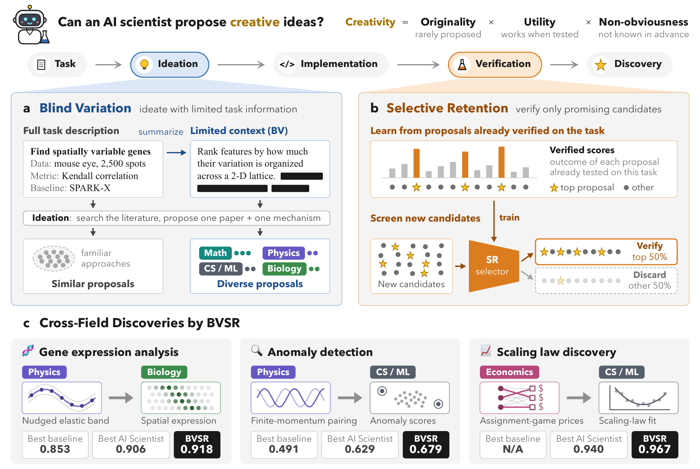
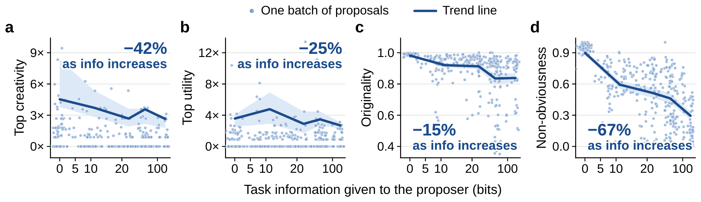
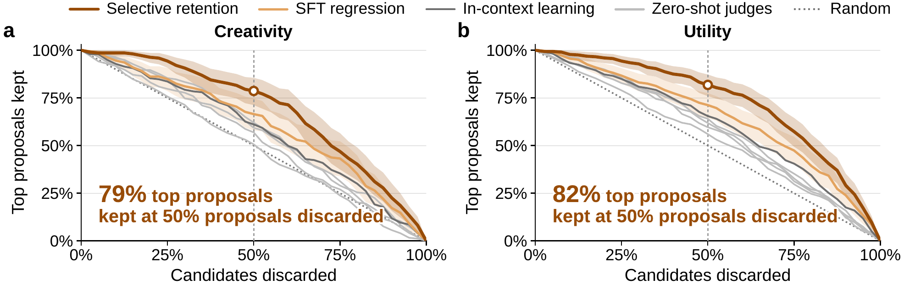
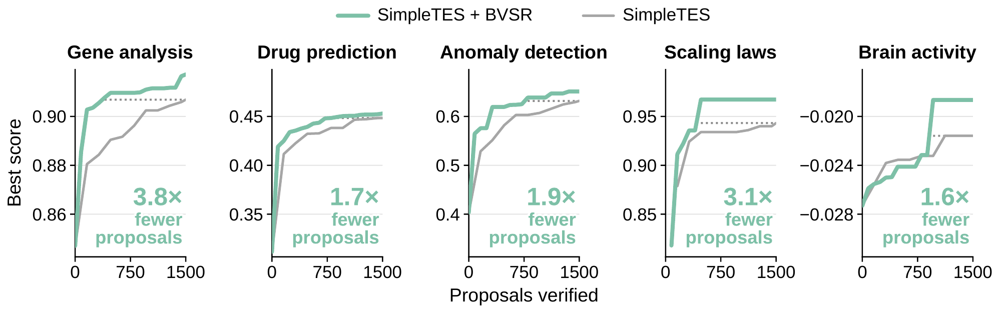

<div align="center">

# Blind Variation, Selective Retention

**Improving creative idea generation in AI scientists.**

[][#arxiv-paper-package]
[][#website-package]
[][#huggingface-package]

[#arxiv-paper-package]: https://arxiv.org/abs/XXXX.XXXXX
[#website-package]: https://zou-group.github.io/BVSR/
[#huggingface-package]: https://huggingface.co/datasets/Xkev/BVSR-data

</div>

AI scientists are usually given as much task information as possible when they generate ideas, which anchors them
on familiar approaches. **BVSR** separates the two roles that information plays in discovery. **Blind variation
(BV)** generates proposals under deliberately limited task information to broaden exploration. **Selective
retention (SR)** learns from proposals already verified on the same task to keep the promising candidates for
costly empirical evaluation.

<p align="center">
  
</p>

## What we found

- **Less task information, more creative ideas.** As the information given to the proposer grows from 0 to 140
  bits, the share of proposals in a task's top 1% falls by 42% for creativity and 25% for utility, mean
  originality falls by 15% and mean non-obviousness by 67%.

<p align="center">
  
</p>

- **Learning from verified proposals keeps the best ones.** A selector trained with a pairwise loss that
  separates each run's top 5% of verified proposals from the rest discards half of the new candidates while keeping
  79% of the top-5% proposals by creativity and 82% by utility, ahead of SFT regression and prompt-based judges.

<p align="center">
  
</p>

- **Stronger discoveries in an existing AI-scientist workflow.** Plugged into SimpleTES, BVSR reaches a higher
  final score on gene expression analysis, drug response prediction, anomaly detection, scaling law discovery
  and brain activity prediction, and reaches SimpleTES's final score with 1.6 to 3.8 times fewer verified
  proposals.

<p align="center">
  
</p>

## Install

```bash
git clone https://github.com/zou-group/BVSR.git && cd BVSR
pip install -r requirements.txt && pip install -e .      # Python 3.12
```

## Reproduce from the released data

```bash
bash reproduce.sh
```

This downloads the released results, the Hugging Face dataset
[`Xkev/BVSR-data`](https://huggingface.co/datasets/Xkev/BVSR-data), into `data/`.

- `data/bv_results`
- `data/sr_data`
- `data/bvsr_simpletes`

It then writes:

| File | Content |
|---|---|
| `results/table1.md` | Table 1 |
| `results/fig2.pdf` | Fig. 2 |
| `results/fig3.pdf` | Fig. 3 |
| `results/fig4.pdf` | Fig. 4 |

## Rerun the experiments

```bash
pip install --no-build-isolation causal-conv1d==1.7.0
export TOGETHER_API_KEY=... OPENAI_API_KEY=...
bash reproduce.sh --rerun
```

It also needs:

- a Hugging Face token with access to the gated `meta-llama/Llama-3.1-8B-Instruct` and `google/gemma-3-4b-it`;
- the `aws` CLI, for the OpenProblems data on S3 (no account needed);
- bubblewrap (`/usr/bin/bwrap`), for the sandboxed evaluators;
- GPUs: the SR and SFT selectors are full fine-tunes of `Qwen/Qwen3.5-9B-Base` on one GPU, and the information
  measure, the brain activity tasks and the SR server also run on GPU;
- optionally `OPENALEX_API_KEY` and `OPENALEX_MAILTO`, for the OpenAlex search.

This reruns blind variation, selective retention and SimpleTES and writes the same files to `results/`. Three
inputs come from the released data and are not recomputed: the baselines of Table 1 and Fig. 2, the
prompt-based judge rankings of Fig. 3 and the SR training and evaluation sets.

1. **Task data and SimpleTES.** Besides the released data, it downloads the data of the 12 tasks.
2. **Blind variation.** For each of the 12 tasks and 5 proposers, it generates 112 proposals under each of
   the task's four contexts, from no task information to full task information. It then verifies them,
   labels their creativity, measures the information of every context, and draws Table 1 and
   Fig. 2.
3. **Selective retention.** It trains the SR selector (`bvsr.sr.train_sr`) and the SFT baseline (`bvsr.sr.train_sft`)
   on the released training set and ranks the released evaluation set with both.
4. **BVSR in SimpleTES.** It serves the selector on GPU, runs the SimpleTES runs of Fig. 4 on the five tasks, and
   draws Fig. 4.

## Repository layout

```
reproduce.sh   the one entry point: released data (default) or --rerun
bvsr/bv/       blind variation, creativity labels, information of the contexts
bvsr/sr/       selective retention: selector training (train_sr), scoring, evaluation
bvsr/stes/     BVSR in SimpleTES
bvsr/tasks/    the 12 tasks
bvsr/retrieval/  OpenAlex search
bvsr/metrics/  originality, utility, non-obviousness, creativity
third_party/simpletes/  the SimpleTES patch
third_party/fonts/      the font of the figures
```

The released SR selector is [`Xkev/SR-judger`](https://huggingface.co/Xkev/SR-judger).

## Citation

If you find BVSR useful in your research, please consider citing our paper.

```bibtex
@article{xu2026bvsr,
  title   = {Blind Variation, Selective Retention: Improving Creative Idea Generation in AI Scientists},
  author  = {Xu, Guowei and Zou, Jiaru and Erdogan, Mete and Ye, Haotian and Lu, Pan and Zou, James},
  journal = {arXiv preprint arXiv:XXXX.XXXXX},
  year    = {2026}
}
```
